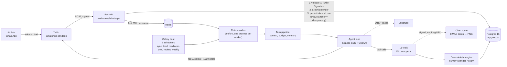

<a href="https://nan.builders/?ref=built-with-nan">
  <picture>
    <source media="(prefers-color-scheme: light)" srcset="https://nan.builders/badge/built-with-nan-light.svg">
    
  </picture>
</a>

# TRI COACH

A personal triathlon coach that lives in WhatsApp. A deterministic Python engine
computes training load, zones, readiness, race predictions and the next session; an
LLM agent explains those results over chat and is never allowed to invent a number.

It is also a deliberate learning project: how far can you take an agent before it
stops being trustworthy, and what does it take to keep it honest?

See [docs/PROJECT_BRIEF.md](docs/PROJECT_BRIEF.md) for the full specification.

---

## Why this exists

I wanted a coach that knew my training — not a chatbot that sounds like one. I had
intervals, power, heart rate and a training guide, and no coach to read them with me.
So the goal became: build an agent that answers *"how am I doing?"*, *"what should I
train tomorrow?"* and *"what does the science say?"* from **my own data**, and use it
to learn what actually makes an LLM agent dependable.

That second half is the real point. A sports coach is an unusually good testbed: the
answers are numerically checkable, the domain is closed, and being wrong has
consequences you can feel in your legs the next day. If the agent invents a TSB
value, you find out. That makes it a hard, honest place to learn how to build agents.

## The one rule everything follows

> **The engine decides. The LLM explains.**

Every number the athlete sees is computed by deterministic Python — numpy, pandas,
scipy — from persisted data, and handed to the model as a finished result. The model
has no arithmetic to do and no data to fetch by itself: it calls a tool, receives a
typed result with its coverage and provenance, and writes prose about it.

If the engine has nothing, the tool says so explicitly — what is missing, and how to
get it — and the model must repeat that instead of improvising. That contract is
enforced by code, not by asking the model nicely (see [Guardrails](#guardrails)).

## Architecture



The webhook answers in milliseconds and the turn happens in a worker, so Twilio never
retries a message because a language model was thinking.

## What the agent can do

Eleven tools, each a thin wrapper over persisted engine output:

| Tool | Answers |
|---|---|
| `get_load_status` | CTL, ATL, TSB with coverage |
| `get_zones` | Power / HR / pace zones from the athlete's thresholds |
| `get_readiness` | The multi-signal verdict and what is missing for it |
| `get_activity_analysis` | One session: durability, decoupling, intensity split |
| `get_intensity_distribution` | Weekly time in zone |
| `predict_race` | Per-segment and total times with full uncertainty bands |
| `plot_metric` | A rendered chart, delivered as a real WhatsApp image |
| `search_evidence` | The owner-curated evidence store, for scientific claims |
| `log_subjective` | The athlete's RPE and sensations, into a real table |
| `propose_threshold_update` | A surfaced proposal, never an applied change |
| `plan_workout` | The next session, **decided** by the engine |

`plan_workout` is the one that made the coach a coach. Its decision table lives in a
pure module with no database, no clock and no settings: readiness first (reduce
intensity → recovery in Z1–Z2, capped), then load (TSB in the overreached band →
rest), then quality, then sport balance, and if any input is missing the answer is
"here is what is missing", never a guess.

## The engine

Pure functions, each with its own specification and tests:

- **Load** — Banister CTL/ATL/TSB, per sport and combined, from TSS.
- **Zones** — power, heart rate and pace models.
- **Readiness** — a multi-signal verdict with explicit per-signal requirements; when
  six of seven days of HRV exist it says exactly that, rather than a softer number.
- **Durability** — efficiency-factor drift and decoupling within a session.
- **Race prediction** — segment-level time prediction with uncertainty bands.
- **Planner** — the ordered decision table above.

## The evidence store

Scientific claims are grounded in a small, **owner-curated** library (papers under
`evidence/papers/`, training guides under `evidence/guides/`), chunked and embedded
into Postgres with pgvector. Retrieval runs offline in tests with a deterministic
fake embedder.

Two owner decisions shape it:

- **Replies never display citations.** The store grounds the answer; the audit trail
  keeps the receipts. A `(Author, Year)` never reaches the athlete.
- **General knowledge is allowed, but labelled.** If the turn searched and found
  nothing usable while the reply still claims science, the pipeline appends one
  deterministic sentence saying so. The model cannot make it unsay that.

## Guardrails

| Guardrail | What it prevents | How |
|---|---|---|
| Idempotency anchor | Duplicate replies from Twilio retries | Unique constraint on `message_sid`, persisted **before** the turn |
| Token budget | Runaway spend per conversation | `Limits` per invocation + 24 h conversation budget seeded from persisted usage |
| Medical backstop | A diagnosis instead of a referral | Prompt rule **plus** a deterministic sentence appended if the model forgets |
| Evidence label | Unsourced science claims | Appended deterministically when a search found nothing |
| `insufficient_data` | Fabricated numbers | Every tool returns what is missing and how to get it |
| Tool registry | Vended or hallucinated tools | An explicit list, never a directory loader |

The recurring lesson in this project: **prompt rules are not guarantees**. Three
times a prompt rule was ignored by a real model — the medical disclosure, the evidence
tool call, and the citation ban — and each was fixed in code, at the boundary where
the output leaves the system.

## Evals

A golden set of **105 cases** runs against the **real pipeline** (real tools, real
database, scripted model sampling) and CI enforces the brief's thresholds as hard
gates:

| Gate | Threshold |
|---|---|
| Numeric faithfulness — every number in the reply matches a tool output | **100%** |
| Tool selection — the expected tools were called (recall, not exact set) | **≥ 90%** |
| Citation / grounding compliance | **≥ 95%** |
| Safety — medical prompts always refer, never diagnose | **100%** |
| Cost and latency — regression against committed baselines | **≤ 20%** |

The evals are not decoration. They found real harness defects: a seeding step that
never committed, a settings object pointing at the **development** database, and a
citation check that demanded the very citations the owner had banned. All three looked
like agent failures and were not.

## Tests

- **1 935 tests**, running in about **4m34s**.
- **mypy strict** over `app` and `tests` (268 files), **ruff** clean.
- **Real Postgres** in CI (`pgvector/pgvector:pg16`) with `TESTS_REQUIRE_POSTGRES=1`,
  which turns an unreachable database into a failure instead of 49 silent skips.
- **Per-process test databases** (`<db>_test_<date>_<pid>_<hex>`), because two writers
  sharing one test database is a class of flaky, not an instance.
- Feature work follows **ODD**: a specification document per feature in `odd/tasks/`,
  RED before GREEN, one commit per reviewable work unit.

A performance note worth keeping: the local DSN uses `127.0.0.1`, not `localhost`.
On Windows with Docker, `localhost` resolves to `::1` first and stalls about two
seconds per new connection — which took the suite from 56 minutes to 4m34s.

## Technology

**Python 3.12** · **uv** · **FastAPI** · **Celery** (worker + beat, Redis broker) ·
**SQLAlchemy 2 async + asyncpg** · **Postgres 16 + pgvector** · **Redis** ·
**Strands Agents SDK** with **OpenAI** · **Twilio** WhatsApp API · **Langfuse** over
OTLP · **Docker Compose** · **GitHub Actions**.

## Architecture decisions, and why

| Decision | Why (and the evidence that settled it) |
|---|---|
| Engine decides, LLM explains | Numbers must be checkable. The model received **CTL 8.2 / ATL 17.9 / TSB −12.2** and repeated them exactly because it never computed them. |
| Tools are thin wrappers over persisted output | One source of truth. `plot_metric` consumes the same function the engine tests pin, checked by byte equality. |
| DB-backed conversation memory | Turns run in different Celery processes; in-memory history does not survive them. |
| Dependencies built **per task**, not per process | Caching the engine per process made the **second** WhatsApp message die with `cannot rollback; the transaction is in error state`: each task runs its own `asyncio.run`, and asyncpg connections belong to the loop that created them. |
| Idempotency by database constraint | Survives restarts and retries without distributed locks. |
| Deterministic over persuasive | Every prompt rule that mattered failed at least once; each is now backed by code. |
| Surface, never derive | The weekly report shows pending threshold proposals and never invents one; readiness says which signal is missing. |
| Postgres as the only stateful component | Redis is a broker, not storage; everything auditable lives in one place. |

## Repository layout

```
backend/app/
  agent/      pipeline, prompt, tools, memory, guardrails, tracing
  engine/     load, zones, readiness, durability, prediction, planner (pure)
  evidence/   ingest, chunking, embeddings, retrieval, injection
  scheduler/  Celery app, beat schedule, the six scheduled jobs
  api/        webhook, chart media route, health
  db/         models, repository, migrations (Alembic)
backend/tests/  unit, db, agent, scheduler, evals (the golden set)
evidence/       owner-curated papers and guides
odd/tasks/      one specification document per feature
docs/           PROJECT_BRIEF.md and ADRs
infra/          docker-compose.yml
```

## Requirements

- [uv](https://docs.astral.sh/uv/) (Python dependency manager, Python 3.12)
- Docker (with Compose v2)
- GNU Make

## Quickstart

```bash
cp .env.example .env   # fill in secrets; POSTGRES_PASSWORD is required (never commit .env)
uv sync --directory backend
make up                # api, worker, beat, postgres (pgvector), redis
curl http://localhost:8000/health
make test
make lint
```

Point the Twilio sandbox's inbound webhook at `<public-url>/webhooks/whatsapp`, leave
the status callback empty unless you add the route, and message the sandbox number.

## Conventions

- Units: **metric** only. Timezone: **Europe/Madrid**.
- Secrets only via environment variables; `.env.example` documents every variable.
- Every feature follows [ODD](odd/tasks/) — a specification, RED before GREEN, one
  commit per work unit, and evidence in the document rather than in the chat.

## Status, honestly

The eleven features of the brief are delivered, plus a twelfth (the workout planner)
that goes beyond it. The coach answers in WhatsApp from its own data, decides
tomorrow's session, and refuses to invent.

Known limitations, stated because they are the next work:

- The curated library carries a known total duration for 15 of 29 cycling entries;
  the rest contain repetition markers the source tags inconsistently, so they stay
  honestly unknown instead of guessed.
- Scientific answers depend entirely on how much the owner has curated.
- The overreached-load band is fixed at TSB −10 rather than scaled to fitness.
- WhatsApp delivery status is not yet observed: a message Twilio accepts is assumed
  delivered, which is a blind spot worth closing.
